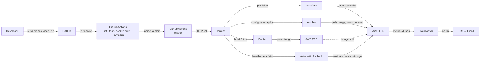

# RetailEdge API — End-to-End CI/CD Pipeline on AWS

A Node.js REST API that deploys itself. Merging a pull request to `main` triggers a fully automated pipeline — test, build, scan, provision, deploy, and verify — that puts the change live on AWS in minutes, with automatic rollback if the release fails its health check.


---

## Table of contents

- [Why this project exists](#why-this-project-exists)
- [Architecture](#architecture)
- [How a deployment actually happens](#how-a-deployment-actually-happens)
- [Tech stack](#tech-stack)
- [Project structure](#project-structure)
- [Key design decisions](#key-design-decisions)
- [How rollback works](#how-rollback-works)
- [Security](#security)
- [Monitoring](#monitoring)
- [Real problems solved while building this](#real-problems-solved-while-building-this)
- [Running it locally](#running-it-locally)
- [Reproducing this infrastructure](#reproducing-this-infrastructure)
- [What I'd improve next](#what-id-improve-next)
- [License](#license)

---

## Why this project exists

Manually deploying an application — SSH into a server, pull new code, restart a process, hope nothing breaks — doesn't scale and doesn't recover from mistakes gracefully. This project replaces that with a pipeline where:

- Every pull request is automatically linted, tested, built into a Docker image, and scanned for known vulnerabilities before it can be merged.
- Every merge to `main` deploys to AWS automatically, with no manual steps.
- Every deployment is verified with a live health check before it's considered successful.
- A failed release is automatically rolled back to the last known-good version — no manual intervention required to restore service.
- The entire infrastructure — network, firewall, server, container registry, alarms — is defined as code and can be rebuilt from scratch.

The application itself (a small products API) is intentionally simple. The point of this project is the pipeline that builds, tests, secures, and ships it.

## Architecture



**Separation of concerns, by design:** GitHub Actions owns the pull-request lifecycle (fast feedback, no AWS credentials needed). Jenkins owns the deployment lifecycle (build, provision, deploy, verify, roll back). Terraform owns what infrastructure *exists*. Ansible owns what runs *on* that infrastructure. Each tool has exactly one job.

## How a deployment actually happens

1. **Open a pull request.** GitHub Actions runs lint, the test suite (with coverage), a Docker build smoke test, and a Trivy vulnerability scan. A branch protection rule blocks merging until all four pass.
2. **Merge to `main` (or push to `release/**`).** A second GitHub Actions workflow fires and makes a single authenticated HTTP call to Jenkins, passing the commit SHA and the target environment — `staging` for `main`, `production` for a `release/*` branch.
3. **Checkout.** Jenkins checks out the exact commit and computes a 7-character image tag from the Git SHA.
4. **Install & Test.** Tests run again, inside a clean, throwaway `node:20-alpine` container — proving the code works in a controlled environment, not just on a previous runner.
5. **Docker Build.** The production image is built and tagged `retailedge-api:<sha>`.
6. **Integration Test.** The freshly built image is actually started as a container and its `/health` endpoint is called, before anything is pushed anywhere.
7. **Push to ECR.** The image is pushed to a private AWS ECR repository, authenticated via the Jenkins server's IAM role — no stored credentials.
8. **Approval (production only).** Jenkins pauses for a manual sign-off before a production deployment proceeds.
9. **Terraform Apply.** Terraform selects the workspace matching the target environment and reconciles AWS infrastructure against code. In steady state, this is a no-op — infrastructure already matches.
10. **Ansible Deploy.** Ansible connects over SSH, ensures the server is correctly configured, saves the currently-running image tag for rollback purposes, pulls the new image, and starts it.
11. **Health Check.** Jenkins calls the live `/health` endpoint with retries. Success ends the pipeline. Failure triggers an automatic rollback (see below) and fails the build with a clear message.

A full run, once infrastructure already exists, takes roughly 5–8 minutes.

## Tech stack

| Layer | Tool | Role |
|---|---|---|
| Application | Node.js 20, Express 5 | REST API |
| Testing | Jest, Supertest | Unit and HTTP-level tests |
| Containerization | Docker (multi-stage) | Reproducible, minimal runtime image |
| PR automation | GitHub Actions | Lint, test, build, and scan every pull request |
| Deployment automation | Jenkins | Orchestrates build → provision → deploy → verify |
| Infrastructure as Code | Terraform | VPC, security groups, EC2, ECR, CloudWatch alarms |
| Configuration management | Ansible | Server hardening, Docker setup, container deployment, rollback |
| Compute | AWS EC2 | Runs the application container |
| Image registry | AWS ECR | Private, scanned Docker image storage |
| State storage | AWS S3 + DynamoDB | Terraform remote state with locking |
| Observability | AWS CloudWatch + SNS | Metrics, logs, and email alarms |
| Vulnerability scanning | Trivy | CVE scanning on every PR and image push |
| Secrets | Ansible Vault, Jenkins Credentials Store, GitHub Secrets | No plaintext secrets anywhere in the repo |

## Project structure

```text
retailedge-api/
├── .github/workflows/
│   ├── pr-checks.yml        # Lint, test, Docker build, Trivy scan on every PR
│   └── deploy.yml           # Triggers Jenkins on merge to main / release/**
├── src/
│   ├── app.js                # Express application and routes
│   └── server.js             # Entry point
├── tests/
│   └── api.test.js           # Jest + Supertest test suite
├── public/
│   └── index.html             # Static homepage served by Express
├── terraform/
│   ├── main.tf, variables.tf, outputs.tf, backend.tf
│   ├── env/                   # Per-environment .tfvars (staging, production)
│   └── modules/
│       ├── networking/        # VPC, subnet, internet gateway
│       ├── security/          # Security group / firewall rules
│       ├── compute/           # EC2 instance, IAM role, Elastic IP
│       ├── ecr/                # Docker image registry
│       └── monitoring/        # CloudWatch alarms, SNS topic
├── ansible/
│   ├── ansible.cfg
│   ├── inventory/              # Target servers per environment
│   ├── playbooks/
│   │   ├── deploy.yml
│   │   └── rollback.yml
│   ├── roles/
│   │   ├── common/             # OS hardening, CloudWatch agent
│   │   ├── docker/             # Docker install & ECR credential helper
│   │   └── app/                # Pull image, run container, save rollback state
│   └── group_vars/all.yml      # Shared variables (Vault-encrypted secrets)
├── Dockerfile                  # Multi-stage, non-root production image
├── docker-compose.yml          # Local development stack
├── Jenkinsfile                  # The full deployment pipeline, as code
├── eslint.config.js
└── package.json
```

## Key design decisions

**Images are tagged with the Git SHA, never `latest`.**
`retailedge-api:<7-char-sha>` means any running container can be traced back to the exact commit that produced it. `latest` is ambiguous and makes rollback imprecise; it's only ever pushed as an extra tag for production, alongside the real SHA tag.

**IAM roles instead of access keys.**
Both the Jenkins server and the application server authenticate to AWS through attached IAM roles. There are no long-lived access keys on either machine — nothing to leak, nothing to rotate.

**Terraform state in S3, locked with DynamoDB.**
State is the source of truth mapping code to real AWS resources. Storing it in S3 makes it durable and shared rather than living on one laptop; the DynamoDB lock table prevents two concurrent applies from corrupting it.

**One Terraform codebase, two environments via workspaces.**
`local.environment = terraform.workspace` means `staging` and `production` are the same module code, applied twice, each with its own state file and its own full set of resources.

**Secrets are encrypted, never plaintext.**
The database password is encrypted with Ansible Vault and committed safely — without the vault password, stored only in Jenkins's credential store, it's unreadable. GitHub Secrets hold the Jenkins API token; Jenkins's own Credentials Store holds the SSH key and vault password. Nothing sensitive is ever in the repository in plaintext.

**The production image runs as a non-root user with no package manager.**
UID 1001, not root. npm and npx are removed from the final image entirely, since the app runs with plain `node` and never needs them at runtime — this also eliminates a real CRITICAL CVE that was bundled inside npm itself (see below).

**ECR authentication via credential helper, not manual login.**
Docker authenticates to ECR automatically through the `amazon-ecr-credential-helper`, configured once. No `docker login` step, no token that can go stale mid-deploy.

**Every Ansible task is idempotent.**
Running the deployment playbook twice against an already-correct server changes almost nothing the second time. That's what makes it safe to run on every single deploy, not just a server's first boot.

## How rollback works

Before replacing a running container, the deployment role checks what's currently running and — if it differs from the version about to be deployed — writes that tag to a file on the server (`/etc/retailedge_previous_tag`). The new version is then deployed and Jenkins calls its health endpoint.

If the health check fails, Jenkins automatically runs the rollback playbook, which reads that saved tag and restarts the previous, known-good image — already cached locally on the server, so this is fast and requires no network pull. The build is marked failed so there's a clear record that something went wrong, but the live application is restored to a working state without any manual intervention.

## Security

- No stored AWS credentials on any server — IAM roles only.
- SSH access restricted to the Jenkins server's IP address alone.
- Database password encrypted with Ansible Vault; vault password never committed.
- All pipeline secrets (SSH key, vault password, Jenkins API token) stored in GitHub Secrets or the Jenkins Credentials Store, never in code.
- Every pull request is scanned for known CVEs with Trivy; CRITICAL findings block the merge.
- ECR scans every pushed image automatically, with a lifecycle policy expiring images after 30 days.
- The production container runs as a non-root user with the package manager removed.
- EBS volumes are encrypted; EC2 requires IMDSv2 (hardened instance metadata access).

## Monitoring

CloudWatch tracks CPU (built-in), memory, and disk usage (via the CloudWatch agent installed by Ansible), with alarms firing through SNS to email at 80% CPU, 85% memory, and 90% disk. Application container logs are shipped to a dedicated CloudWatch log group for centralized troubleshooting without needing to SSH into the server.

## Real problems solved while building this

A few of the genuine issues hit (and fixed) during development — included because they're more useful than a list of tool names:

- **A real CRITICAL CVE, traced and fixed properly.** Trivy flagged a vulnerability in `tar`. `npm ls tar` showed it wasn't in this project's own dependencies at all — it turned out to be bundled inside npm itself, inside the base image. The fix wasn't a suppression; npm and npx were removed entirely from the production image, since the app never calls them at runtime.
- **Dependency installation on Amazon Linux.** Installing the Docker Python SDK via `pip` failed under Amazon Linux's externally-managed-environment restriction. Fixed by installing the OS package (`python3-docker`) directly instead.
- **A cleaner ECR authentication pattern.** The original approach ran `aws ecr get-login-password | docker login` before every pull. This was replaced with the ECR credential helper, which authenticates automatically and never goes stale — a genuine improvement over the initial design, not just a different way to do the same thing.

## Running it locally

```bash
git clone https://github.com/StevePillai/retailedge-api.git
cd retailedge-api
npm install
npm run lint
npm test
npm start
```

The API is then available at `http://localhost:3000`. A `docker-compose.yml` is also included for a local multi-container stack (app, PostgreSQL, Redis):

```bash
docker compose up --build
```

## Reproducing this infrastructure

This repository is self-contained: cloning it and following the Terraform and Ansible setup will reproduce the same AWS environment from scratch. At a high level:

1. Create an S3 bucket and DynamoDB table for Terraform state.
2. Generate an SSH key pair for Ansible and place the public half at `terraform/deployer.pub`.
3. `terraform init && terraform workspace new staging && terraform apply -var-file=env/staging.tfvars`.
4. Configure Jenkins with the required credentials (SSH key, Ansible Vault password) and point a pipeline job at this repository's `Jenkinsfile`.
5. Push to `main` and watch the pipeline deploy.

## What I'd improve next

- Put an Application Load Balancer in front of the app and close the application port to direct public access, with HTTPS terminated at the load balancer.
- Move runtime secrets to AWS Secrets Manager for easier rotation without a redeploy.
- Run two instances behind a load balancer to eliminate the brief downtime during a container swap.
- Narrow the Jenkins IAM role from broad managed policies to a tightly scoped custom policy.
- Pin the Trivy GitHub Action to an exact released version instead of a floating tag.

## License

MIT — see [LICENSE](LICENSE) for details.

---

*Built as a hands-on project to understand how production CI/CD pipelines actually work — not just the tools individually, but how they fit together.*
